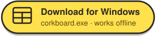
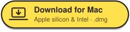
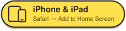
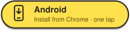
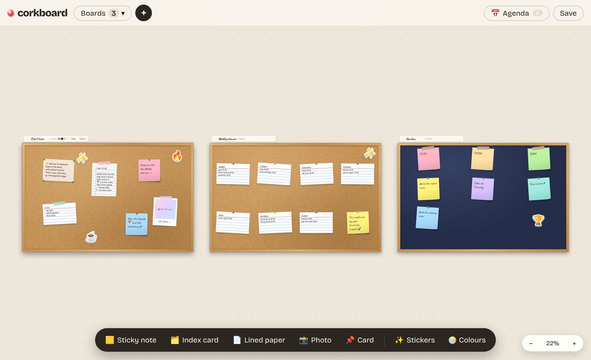

# corkboard

**An endless wall of cork boards on your laptop and phone.** Pin sticky notes, index cards, lined paper, polaroids,
stickers and washi tape; plan your week, run a kanban, build a moodboard. Write a time next to a plan and it lands in
your agenda and on your desktop widget. For Windows, Mac, iPhone, iPad and Android. No account, no server: everything stays on your device.


Made for the way people actually plan: students with exams and group projects, office folks juggling tasks and
meetings, and anyone who thinks better with paper on a wall.

## Install

<p align="center">
  <a href="https://github.com/Epinnn14/corkboard/releases/latest/download/corkboard.exe"></a>
  &nbsp;
  <a href="https://github.com/Epinnn14/corkboard/releases/latest/download/corkboard-mac.dmg"></a>
  <br>
  <a href="https://epinnn14.github.io/corkboard/#install=ios"></a>
  &nbsp;
  <a href="https://epinnn14.github.io/corkboard/#install=android"></a>
</p>

| Device | How |
|---|---|
| **Windows** | The button downloads `corkboard.exe`. Open it: corkboard installs itself, starts, and puts its widget on your desktop. If Windows says the publisher is unknown (the app isn't code-signed): *More info → Run anyway*. |
| **Mac** | The button downloads `corkboard-mac.dmg` (Apple silicon and Intel). Open it and drag corkboard into **Applications**. The first time, macOS can't check the app (it isn't signed by Apple): click *Done*, then *System Settings → Privacy & Security → Open Anyway*. |
| **iPhone / iPad** | Apple only lets the App Store install apps, so corkboard goes on the home screen from the browser (its own icon, offline). **Safari:** tap **Share ⬆**: top right on iPad (left of **+**, not the ≡ menu by the address); on iPhone tap **⋯** at the bottom right first. **Chrome:** Share ⬆ in the address bar. **Edge:** ⋯ → Share. **Firefox:** ≡ → Share. Then *Add to Home Screen* → *Add*. The install window shows an arrow pointing at the button. |
| **Android** | The button opens corkboard with an **Install now** button. Or from the menu: Chrome / Opera / Brave *⋮ → Install app*, Samsung Internet *≡ → Add page to → Home screen*, Edge *⋯ → Add to phone*, Firefox *⋮ → Add app to Home screen*. |

The Windows and Mac downloads work from any browser (Chrome, Edge, Safari, Firefox, Opera …).

On Windows and Mac it runs **on your computer, no internet needed**: boards are saved there, the date and time follow
the computer's clock, reminders pop up as notifications, and the widget starts with the computer while it's on.


On a phone or tablet, scan the code: it opens the install window for that device. Or just use corkboard in the
browser: **[epinnn14.github.io/corkboard](https://epinnn14.github.io/corkboard/)**.

<details>
<summary>Mac: “corkboard is damaged” or no <i>Open Anyway</i> button?</summary>

Open Terminal and run this once, then open corkboard again:

```bash
xattr -cr /Applications/corkboard.app
```

</details>

## How to use it

The first time, you see every board: **Start here** (what corkboard is, with a *How to use* note), a **Weekly planner**
already filled in (its times are in the agenda and the widget straight away) and a **Kanban**. Change them, or remove
them with a board's *Delete* button.



| | |
|---|---|
| Add a note | double-click the board, or use the dock at the bottom |
| Write | click a note |
| Move | drag a note (also onto another board); drag a board by its frame or name tag |
| Pan / zoom | drag empty space (also inside a board) · scroll wheel or pinch · `+` `−` · `0` shows every board |
| Change a note | select it: colour, tape or pin, 📅 date, duplicate, remove |
| Plan with times | write the time next to the thing: `gym 18.00`, under a `MONDAY` heading or with a day (`fri 3pm`) |
| Tick things off | the checkbox in the agenda or the circle on the widget: the line gets crossed out |
| Undo | the toast's **Undo**, or `Ctrl/⌘ + Z` |
| Keys | `N` new sticky · `B` new board · `A` agenda · `Delete` remove · `Esc` deselect |
| Keep / share | **Save** downloads the board as a PNG · **+** has new boards, import and export |

## Boards and notes

The workspace has no edges: add a board for every class, client or side quest, zoom out to see them all, and drag a
note from one board straight onto another. Boards are landscape on wide screens and portrait on phones.


| Template | What's on it |
|---|---|
| 🗓️ **Weekly planner** | an index card for each day + the week's one big goal |
| ✅ **Kanban** | To do → Doing → Done, on midnight felt |
| 📚 **Study plan** | exam card, topics checklist, schedule, pomodoro, study buddy photo |
| 🌈 **Moodboard** | taped polaroids and vibe words on blush linen |
| 💡 **Brainstorm** | one big question in the middle, a ring of rainbow stickies |

<p align="center">
  
  &nbsp;
  
</p>

- **Sticky notes** in 12 colours plus any colour you pick, **index cards**, **lined paper**, **cards** with four pins.
- **Polaroids**: tap the picture to add your own photo, write a caption underneath.
- **Stickers** (24 die-cut emoji), **washi tape** instead of a pin, four **surfaces**: cork, felt, linen, dot-grid paper.

## Agenda


- **Times you write go on the agenda by themselves.** Under a `MONDAY` heading, `buy milk 10.00` becomes
  *Monday 10:00 · buy milk*. It reads `10.00`, `10:00`, `3pm`, `7.30 pm`, `jam 10`, `pukul 14.15`, and days as
  *today*, *tomorrow / besok*, weekday names in English or Indonesian, `12/11`, `12 Nov`, `2026-11-12`.
- **A box per day** (Overdue, Today, Tomorrow, then each day), every item with its time. Tick one and it's crossed
  out, in the agenda and in the note. Under each item, **+ add a note** for your own details.
- **Dates and reminders** on any note with 📅: a day, a time, and a reminder at the time, 10 min, 1 h or 1 day before.
- Reminders pop up while corkboard is open; on Windows and Mac the widget keeps it open all day.
- **📆 Add to my calendar** puts everything still to come into Windows Calendar, Outlook, Google or Apple Calendar (.ics).

## Desktop widget

<p align="center"></p>

- A tear-off calendar page with the time, and **today's notes** on a sticky. Tick them off right there; **‹ ›**
  flips to other days. Add *Coming up* (the next 7 days) or a mini board if you like.
- Four styles: **Cork**, **Paper**, **Dark**, or **Notes only** (just the papers on your desktop).
- **Any size**, from one sticky note up to the whole screen: drag its bottom-left corner, or pick a size in *Customize*.
  Move it by its top middle. *Show the widget* brings it to the top-right corner.
- In the Windows and Mac app it stays on the desktop when you close corkboard, and **starts with the computer while
  it's on**. Close the widget yourself (⋯ → *Close widget*) and it stops starting up, until you show it again.
- On a phone or in the browser: **+** → *Desktop widget* → *Open widget*, or *Widget mode*.

## Import & export

**Import** from the **+** menu (several files at once):

| File | Becomes |
|---|---|
| `.txt`, `.html` | a board named after the file: short paragraphs → stickies, longer → index cards or lined paper |
| `.md` | the same, `# Title` names the board and `## Headings` become index cards |
| `.csv` | one note per row, labelled by the header |
| `.pdf`, `.docx` | the document's text, split into notes |
| images | polaroids on the current board |
| `.json` | a corkboard backup |

**Export** every board as Word, PDF (a picture of each board plus all the text), plain text, Markdown or a JSON backup.
The backup is also how you move boards between the website and the desktop app.

## For developers

```bash
npm install
npm run dev       # http://localhost:5173
npm test          # 99 tests
npm run build     # the website in dist/ (relative paths, host it anywhere)
```

The Windows and Mac app (Electron) is in `desktop/`:

```bash
npm run build                 # the website first
cd desktop && npm install
npm start                     # run it
npm run dist                  # desktop/release/corkboard.exe (on Windows)
npm run dist:mac              # desktop/release/corkboard-mac.dmg (on a Mac)
```

Every push to `main` runs the tests, deploys the website to GitHub Pages, builds `corkboard.exe` on a Windows runner
and `corkboard-mac.dmg` on a Mac runner, and puts both on the release of the current version. Boards saved by older
versions are upgraded automatically.

**Built with** Vue 3 · Pinia · TypeScript · Vite · vite-plugin-pwa · Electron · idb-keyval · html-to-image · pdf.js ·
mammoth · docx · jsPDF · Fontsource (Bricolage Grotesque, Caveat, Patrick Hand) · Vitest.

<details>
<summary>Project layout</summary>

```
src/
├── core/                 plain TypeScript, no Vue
│   ├── board.ts          notes, colours, stickers, tapes, surfaces, safe parsing
│   ├── workspace.ts      camera, board placement, hit-testing, file import
│   ├── templates.ts      planner / kanban / study / moodboard / brainstorm layouts
│   ├── convert.ts        text / markdown / csv → notes, notes → txt / md
│   ├── io.ts             file readers (pdf.js, mammoth) and writers (docx, jsPDF)
│   ├── dates.ts          due dates, agenda days, reminders, .ics
│   ├── detect.ts         times and days written in notes → agenda items
│   ├── desk.ts           widget settings, sizes, the day's list
│   ├── desktop.ts        the bridge to the desktop app
│   ├── sync.ts           autosave, keeping several windows in step
│   ├── install.ts        install steps per device and browser
│   ├── notify.ts         system notifications
│   ├── texture.ts        cork, felt, linen and paper surfaces drawn on a canvas
│   └── storage.ts        IndexedDB
├── stores/workspace.ts   Pinia: boards, notes, drops between boards, undo
└── components/           Workspace, BoardView, NoteItem, DueEditor, AgendaPanel,
                          WidgetView, DeskSheet, InstallSheet, PushPin
desktop/
├── main.cjs              tray / menu bar, the widget window, the app window, start with the computer
└── preload.cjs           window.corkboardDesktop for the web app
```

</details>

Everything on screen is drawn with CSS, SVG and canvas. See [ROADMAP.md](ROADMAP.md) for what's next.

## License

MIT
