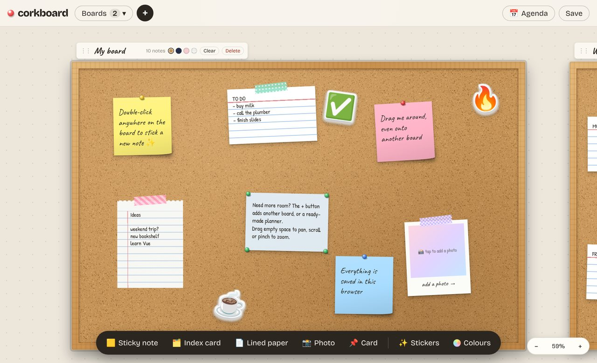
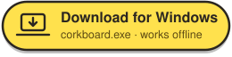
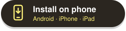
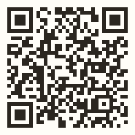
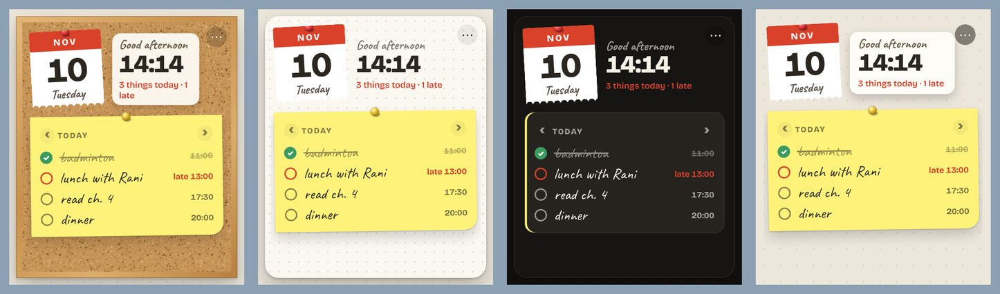
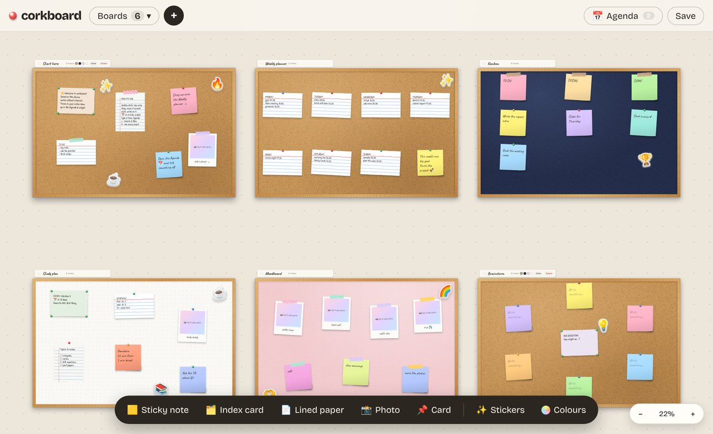
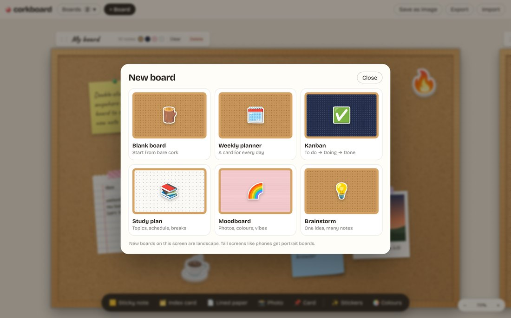
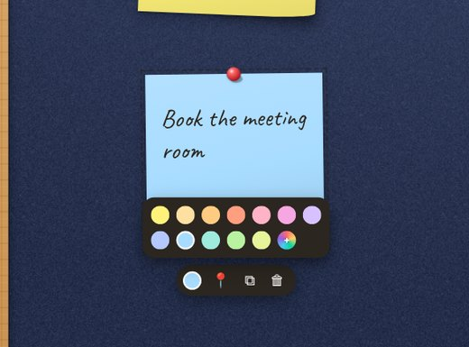
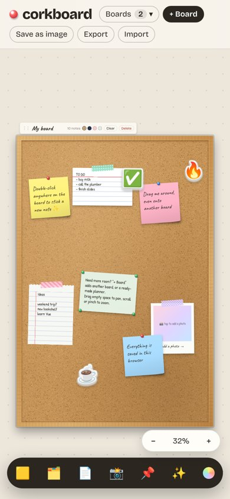
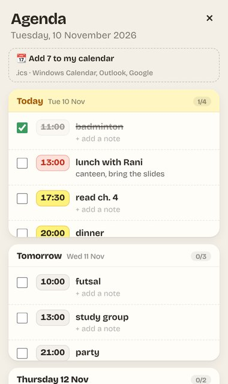

# corkboard

**An endless wall of cork boards in your browser.** Pin sticky notes, index cards, lined paper,
polaroids, stickers and washi tape, plan your week, run a kanban, build a moodboard.
No account, no server: everything stays on your device.



Made for the way people actually plan: students with exams and group projects,
office folks juggling tasks and meetings, and anyone who thinks better with paper on a wall.

## Install

<p align="center">
  <a href="https://github.com/Epinnn14/corkboard/releases/latest/download/corkboard.exe"></a>
  &nbsp;
  <a href="https://epinnn14.github.io/corkboard/#install"></a>
</p>

**On a laptop (Windows):** the button downloads `corkboard.exe` straight away. Open it and corkboard installs itself
and starts, with its widget on your desktop. After that it runs **locally on your laptop, no internet needed**:
your boards are saved on the laptop, the clock, the date and the widget's calendar page follow the laptop's own clock,
reminders pop up as Windows notifications, and **📆 Add to my calendar** in the agenda puts everything into the
laptop's calendar (Windows Calendar, Outlook). Windows may say the publisher is unknown: *More info → Run anyway*.

**On a phone** (or a Mac / Chromebook): **Install on phone** opens corkboard with an install window ready for the
device you're on (or scan the code with your phone camera):



- **Android, Mac / Chromebook (Chrome or Edge):** one **Install now** button, then confirm once. corkboard gets its
  own icon and lands on the home screen, Dock or launcher.
- **iPhone / iPad:** Apple doesn't let websites show an install button, so the window shows the two taps:
  *Share → Add to Home Screen*.

No app store, no account, works offline. To remove it, uninstall it like any other app.

### Windows app: the desktop widget

**[⬇️ Download corkboard.exe](https://github.com/Epinnn14/corkboard/releases/latest/download/corkboard.exe)**

Open the file: corkboard installs itself, starts, and puts its **widget on your desktop**: a tear-off calendar page
and the time, today's reminders on a sticky note (tick them off right there) and what's coming up on an index card.

<p align="center"></p>

- It shows **today's notes** to start with: the time-stamped lines of today's planner card, crossed out when you
  tick them. **‹ ›** on the sticky flips to other days.
- Pick what it shows (date & clock, the day's notes, coming up, a mini board) and its style (Cork, Paper, Dark, or
  **Notes only**: just the papers on your desktop, no backdrop) from the widget's ⋯ menu → *Customize*.
  A mini board's notes sit straight on the widget.
- **Any size**: drag the bottom-left corner, or pick Auto / Small / Medium / Large / Custom. The smallest is one
  sticky note (220 × 220); the biggest is your screen. Drag it by its top strip; it remembers where, and
  *Show the widget* (tray or **+** menu) brings it to the top-right corner.
- Click a reminder to open it in the full corkboard (Start menu / desktop shortcut). Both show the same boards:
  change a note in one, the other follows.
- It sits in the tray and **starts with Windows**, so the widget and your **reminders** are there all day.
  Tray menu: open, customize, show the widget, keep it on top, start with Windows, quit.
- Windows may say the publisher is unknown (the app isn't code-signed): *More info → Run anyway*.
- The app keeps its own boards. To bring your website boards along: **+ → Backup** on the website,
  then **+ → Import files** in the app.

## Boards, as many as you want

The workspace has no edges. Add a board for every class, client or side quest, drag boards
around, zoom out to see everything, and drag a note from one board straight onto another.



New boards come blank or from a template:

| Template | What's on it |
|---|---|
| 🗓️ **Weekly planner** | an index card for each day + the week's one big goal |
| ✅ **Kanban** | To do → Doing → Done, on midnight felt |
| 📚 **Study plan** | exam card, topics checklist, schedule, pomodoro, study buddy photo |
| 🌈 **Moodboard** | taped polaroids and vibe words on blush linen |
| 💡 **Brainstorm** | one big question in the middle, a ring of rainbow stickies |



## On every board

- **Sticky notes** in 12 colours (canary to periwinkle) plus a picker for any colour you like.
- **Index cards**, **lined paper** with a perforated edge, **cards** held by four pins.
- **Polaroids** with your own photos (downscaled to stay light) and a handwritten caption.
- **Stickers**: a sheet of 24 die-cut emoji (✨🔥💯✅📚☕🧠🚀🫶…).
- **Washi tape** instead of a push-pin: pink stripes, mint dots, sun grid, kraft or lilac check.
- **Four surfaces** per board: cork, midnight felt, blush linen, dot-grid paper.
- Boards are **landscape on wide screens and portrait on phones**, picked automatically.

<p align="center">
  
  &nbsp;
  
</p>

## How to use it

| | |
|---|---|
| Add a note | double-click the board, or use the dock at the bottom |
| Write | click a note |
| Move | drag a note (also onto another board), drag a board by its frame or name tag |
| Pan / zoom | drag empty space · scroll wheel or pinch · `+` `−` · `0` shows everything |
| Change a note | select it: colour, tape/pin, duplicate, remove |
| Undo | the toast's **Undo**, or `Ctrl/⌘ + Z` (notes, cleared boards and deleted boards) |
| Dates | select a note → 📅: pick a day and time, a reminder (at time, 10 min, 1 h, 1 day before); tap the chip to tick it done |
| Keys | `N` new sticky · `B` new board · `A` agenda · `Delete` remove · `Esc` deselect |
| Keep / share | **Save** downloads the current board as a PNG · the **+** menu has New board, Import and Export (below) |

## Dates, reminders & widget



- **Times written in a note go on the agenda by themselves**: under a `MONDAY` heading, `buy milk 10.00` becomes
  *Monday 10:00 · buy milk*. It reads 10.00, 10:00, 3pm, 7.30 pm, “jam 10”, “pukul 14.15”; days as today,
  tomorrow/besok, weekday names in English or Indonesian, 12/11, 12 Nov, 2026-11-12. Tick one in the agenda or the
  widget and the line gets crossed out in the note too.
- **Agenda** (top right, or `A`): a box per day (Overdue, Today, Tomorrow, then each day), each item with its time in
  a box. Ticked items stay where they are, crossed out. Under each one, **+ add a note** for your own details
  ("bring the racket"). Click an item to jump to its note; **📆 Add to my calendar** exports everything still to come.
- **Due dates** on any note show a chip (overdue red, today orange, done ticked).
- **Reminders** pop up as a banner and a system notification while corkboard is open (a tab or the installed app).
  For reminders when it is closed, use **Add to calendar** in the date editor: an `.ics` file with an alarm
  (Windows Calendar, Outlook, Apple, Google) or a Google Calendar link.
- **Install as an app** (see [Install](#install)): works offline and gets its own icon, with shortcuts to *Widget*
  and *Agenda*.
- **Desktop widget** (**+** → *Desktop widget*): pick what to show (date & clock, today's reminders, the coming 7 days,
  a mini board) and a style (Cork, Paper, Dark), with a live preview. Get it on your desktop with the
  [Windows app](#windows-app-the-desktop-widget), or *Open widget* in a small browser window.
- **Widget mode** (`#widget`): the same widget in the current window, handy from the home-screen shortcut on a phone.
- **Wallpaper pictures** (in the **+** menu): *Desktop wallpaper* (2560×1440) and *Phone wallpaper* (1170×2532, with the top
  third left clear for the lock-screen clock), so the whole board fits instead of being cropped.

## Import & export

The **+** menu (top left, next to *Boards*) adds boards, turns files into boards and boards into files.

**Import** (pick several files at once):

| File | Becomes |
|---|---|
| `.txt`, `.html` | a board named after the file; short paragraphs → sticky notes, medium → index cards, long → lined paper; bullet lists → one sticky per item |
| `.md` | same, plus `# Title` names the board and `## Headings` become index cards |
| `.csv` | one note per row, labelled by the header (`Due: Fri`) |
| `.pdf` | the PDF's text, split into paragraphs (pdf.js) |
| `.docx` | the Word document's text (mammoth) |
| images | polaroids on the current board |
| `.json` | a corkboard backup |

Big files flow onto extra boards ("Lecture (1)", "Lecture (2)" …).

**Export all boards as:** Word (.docx, sticky colours as shading, photos embedded) · PDF (a picture of each board
plus every note as searchable text) · plain text · Markdown (for Notion/Obsidian) · JSON backup.

## Run it

```bash
npm install
npm run dev       # http://localhost:5173
npm test          # 93 tests
npm run build     # static site in dist/ (relative paths, host it anywhere)
```

Pushing to `main` runs the tests and deploys to GitHub Pages
(*Settings → Pages → Source: GitHub Actions*), and builds `corkboard.exe` on a Windows runner and attaches it
to the GitHub release of the current version (`desktop/package.json`).

The Windows app (Electron) is in `desktop/`:

```bash
npm run build                 # the website, in dist/
cd desktop && npm install
npm start                     # run it
npm run dist                  # desktop/release/corkboard.exe (run on Windows)
``` Workspaces from v1.0 (single board) are migrated automatically.

## How it's built

Vue 3 (`<script setup>`) · Pinia · TypeScript · Vite · idb-keyval · html-to-image · pdf.js · mammoth · docx · jsPDF ·
vite-plugin-pwa · Electron (Windows app) · Fontsource (Bricolage Grotesque, Caveat, Patrick Hand) · Vitest + Vue Test Utils + fake-indexeddb

```
src/
├── core/                 plain TypeScript, no Vue
│   ├── board.ts          notes, colours, stickers, tapes, surfaces, safe parsing
│   ├── workspace.ts      camera (fit, zoom-at-cursor), board placement, hit-testing, file import + v1 migration
│   ├── templates.ts      planner / kanban / study / moodboard / brainstorm layouts (work in both orientations)
│   ├── convert.ts        text / markdown / csv → packed notes across boards, notes → txt / md
│   ├── io.ts             file readers (pdf.js, mammoth) and writers (docx, jsPDF), loaded on demand
│   ├── dates.ts          due dates, agenda groups, reminder timing, .ics and Google Calendar links
│   ├── desk.ts           desktop widget settings, window sizes, today/coming-up lists
│   ├── detect.ts         times and days written in notes → agenda items; crossing a line out
│   ├── desktop.ts        the bridge to the Windows app (widget window, settings)
│   ├── sync.ts           autosave + keeping several corkboard windows in step (BroadcastChannel)
│   ├── install.ts        device/browser detection and install steps
│   ├── notify.ts         system notifications (through the service worker when installed)
│   ├── wallpaper.ts      desktop and phone wallpaper layouts
│   ├── texture.ts        cork, felt, linen and dot-grid surfaces painted on a canvas
│   └── storage.ts        IndexedDB persistence
├── stores/workspace.ts   Pinia: boards, notes, cross-board drops, undo
└── components/
    ├── Workspace.vue     the endless canvas: pan, wheel/pinch zoom
    ├── BoardView.vue     one framed board with its name tag
    ├── NoteItem.vue      one note: drag, edit, paper styles, stickers, tape, toolbar, due chip
    ├── DueEditor.vue     date, reminder and add-to-calendar popover
    ├── AgendaPanel.vue   every dated note across boards
    ├── WidgetView.vue    the widget (#widget): calendar page, today, coming up, mini board
    ├── DeskSheet.vue     "Desktop widget": what it shows, its style, the Windows app or a pop-up
    ├── InstallSheet.vue  the #install window: one-click install or the steps for this device
    └── PushPin.vue
desktop/                  the Windows app (Electron)
├── main.cjs              tray, the widget window, the app window, start with Windows
└── preload.cjs           window.corkboardDesktop for the web app
```

Everything on screen is drawn with CSS, SVG and canvas: no image assets.
See [ROADMAP.md](ROADMAP.md).

## License

MIT
