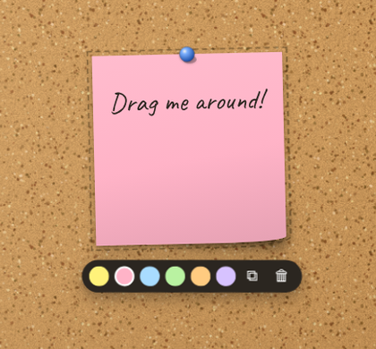

# corkboard

**A cork board in your browser.** Pin sticky notes, index cards, lined paper, cards and
polaroid photos, drag them around, write on them — and everything stays on your device.


No account, no server, no tracking: the board lives in your browser's IndexedDB.
Use it as a personal to-do wall, a mood board, a family notice board on a kitchen tablet,
or a planning wall for a project.

## What you can pin

| | | |
|---|---|---|
| **Sticky note** — 6 colours, curled corner | **Index card** — red header rule, blue lines | **Lined paper** — margin and perforated edge |
| **Photo** — polaroid frame with your own picture and a caption | **Card** — held by four pins | |

Each note gets a slight random tilt and a push-pin, like the real thing.

## Features

- **Double-click** anywhere on the cork to stick a new note there, or use the dock at the bottom.
- **Drag** notes anywhere (mouse or touch); the one you touch comes to the front.
- **Click** a note to write on it — handwritten fonts (Caveat, Patrick Hand) bundled locally.
- Selected notes get a small toolbar: **change colour**, **choose photo**, **duplicate**, **remove** — with **Undo**.
- **Landscape or portrait** board; the board scales to any screen and looks the same everywhere.
- **Save as image** (PNG of the whole board), **Export / Import** the board as JSON.
- Photos are downscaled (≤ 640 px JPEG) before saving so the board stays light.
- Keyboard: `N` new sticky note · `Delete` remove selected · `Ctrl/⌘ + Z` undo remove · `Esc` deselect.

<p align="center"></p>

## Run it

```bash
npm install
npm run dev       # http://localhost:5173
npm test          # 19 tests
npm run build     # static site in dist/ (relative paths — host it anywhere)
```

Pushing to `main` runs the tests and deploys to GitHub Pages
(*Settings → Pages → Source: GitHub Actions*).

## How it's built

Vue 3 (`<script setup>`) · Pinia · TypeScript · Vite · idb-keyval · html-to-image · Fontsource ·
Vitest + Vue Test Utils + fake-indexeddb

```
src/
├── core/
│   ├── board.ts      note model, placement (least-overlap spot), z-order, orientation, safe JSON import
│   ├── storage.ts    IndexedDB persistence
│   ├── texture.ts    procedural cork texture painted on a canvas
│   └── image.ts      photo downscaling
├── stores/board.ts   Pinia store: add / move / select / remove + undo / duplicate
└── components/
    ├── Corkboard.vue the framed board, scaling to fit the window
    ├── NoteItem.vue  one note: drag, edit, per-kind paper styles, toolbar
    └── PushPin.vue   SVG push-pin
```

The board uses fixed logical coordinates (1600×1000 or 1000×1500) and is scaled with CSS,
so positions are identical on a phone, a laptop and a TV. The cork, frame, papers and pins
are drawn with CSS, SVG and canvas — no image assets.

See [ROADMAP.md](ROADMAP.md).

## License

MIT
